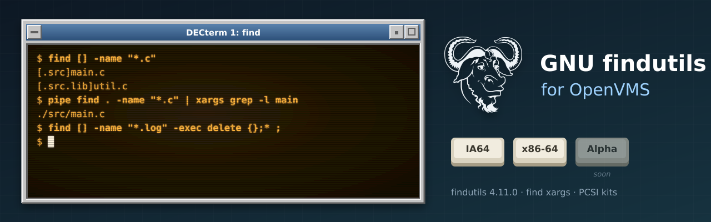

<p align="center">
  
</p>

# vms-findutils

[](https://github.com/issinoho/vms-findutils/releases)

GNU findutils 4.11.0 (find and xargs) for OpenVMS (IA64 and x86-64), built natively with VSI C.

The repository stores only our changes over the signed upstream release:
- `patches/` holds changes to upstream files, applied in `patches/series` order.
- `overlay/` holds new files: VMS build procedures, C RTL shims and the PCSI kit.

`tools/prepare.sh` combines them with the tarball into `staging/`, which is pushed to a VMS node and built there with MMS. The tooling is shared with the other ports in the family; see [vms-grep](https://github.com/issinoho/vms-grep) for the list.

## Status

| Step | IA64 (V8.4-2L3) | x86-64 (E9.2-4) |
|------|-----------------|-----------------|
| Configure with VSI C (`tools/vms_configure.sh`) | done | done (same answers) |
| Build (`tools/build.sh`) | clean | clean |
| DCL smoke test, 25 checks (`tools/test.sh`) | 25/25 | 25/25 |
| PCSI kit `ISSINOHO <base> FINDUTILS V4.11-0E1` (`tools/kit.sh`) | built | built |
| Install check (`tools/installcheck.sh`): install, smoke 25/25, clean removal | pass | pass |

## Using it

```
$ @FINDUTILS$ROOT:[000000]FINDUTILS$SETUP.COM
$ find . -name "*.c"                          ! Unix names: ./src/main.c
$ find [] -name "*.c"                         ! VMS names:  [.src]main.c
$ find [] -name "*.log" -exec delete {};* ;   ! DCL verbs work with VMS names
$ pipe find . -name "*.c" | xargs grep -l main
```

- **Commands:** `-exec`, `-execdir`, `-ok` and xargs run the command as DCL in a subprocess
  (LIB$SPAWN), so DCL verbs, foreign-command symbols and `@procedures` all work. The words
  you type are DCL syntax, so qualifiers work; file names are quoted unless they are VMS file
  specifications. See [docs/DECISIONS.md](docs/DECISIONS.md) D1.
- **File names:** a starting point in VMS syntax (`[]`, `[.dir]`, `DKA0:[X]`, `dir.dir`) gives
  VMS names (`[.dir.sub]file.txt`, a directory as `[.dir]sub.DIR`); a Unix one (`.`, `dir`)
  gives Unix names. See D2.

**Known limits** (also in the kit's README.VMS):
- locate, updatedb and frcode are not included: updatedb is a shell script and needs a DCL
  replacement.
- `xargs -P N` runs one command at a time.
- One subprocess per command: `-exec ... ;` over many files is slow; use `-exec ... +` or
  xargs.
- A command's arguments are limited to about 4000 bytes (DCL's limit); find and xargs split
  longer lists over several commands.
- A `@procedure` gets unquoted parameters upper-cased by DCL, VMS file names included.
- `-fstype` reports `unknown`. With a VMS starting point, `-printf`'s `%h`, `%P` and `%f`
  still give Unix forms.
- `>` on the command line is not redirected by the C RTL; use `PIPE`.

## Workflow

```sh
cp tools/nodes.conf.example tools/nodes.conf   # then fill in the real nodes
tools/prepare.sh                               # fetch, verify, patch, configure, stage
tools/vms_configure.sh <node>                  # once per upstream release: configure with VSI C
tools/build.sh <node>                          # push and build with MMS
tools/test.sh <node>                           # smoke test
tools/kit.sh <node>                            # PCSI kit
tools/installcheck.sh <node>                   # install, verify, remove
```

## What the port changes

| Change | Why |
|---|---|
| `0001-getprogname-vms` | gnulib's `getprogname` has no OpenVMS method |
| `0002-stdlib-vms-exit-severity` + `vms/vms_exit.c` | Under DCL, every non-zero exit (find's 1, xargs's 1 and 123-127) has error severity |
| `0003-config-h-assert-guard-vms` | `<assert.h>` defines `assert` again after `config.h` |
| `0004-stdio-fwrite-records-vms` + `vms/vms_fwrite.c` | Each `fwrite` item would be a record on a record-oriented stdout |
| `0005-open-directory-vms` | The C RTL cannot `open()` a directory: use gnulib's fallback |
| `0006-find-exec-without-fork-vms` + `vms/vms_spawn.c` | No `fork()`: `-exec`, `-execdir`, `-ok` run DCL through LIB$SPAWN ([D1](docs/DECISIONS.md)) |
| `0007-xargs-without-fork-vms` | The same for xargs, with its 123-127 exit statuses; `-P` runs one at a time |
| `0008-buildcmd-dcl-limit-vms` | Command lines sized for DCL (about 4000 bytes of arguments), not `ARG_MAX` |
| `0009-vms-syntax-names` + `vms/vms_names.c` | VMS-syntax starting points give VMS names ([D2](docs/DECISIONS.md)) |
| `vms/vms_mountlist.c` | gnulib's mount list has no OpenVMS method; `-fstype` reports `unknown` |
| `vms-manual.site` | Configure answers the cross run cannot get, such as the C RTL's `getcwd` |
| `vms/vms_crtl_init.c` | DECC$ features: ODS-5 names, Unix name reporting, argument case |

Every problem met and its fix is in [docs/PORTING_LOG.md](docs/PORTING_LOG.md); the design
decisions are in [docs/DECISIONS.md](docs/DECISIONS.md), and the rules and pitfalls for working
on the port in `CLAUDE.md`.

## Artwork

`docs/images/banner.svg` and `docs/images/icon.svg` were made for this project in the style of
classic DECwindows and VT terminals, like those of its sibling ports. They incorporate the
[GNU head](https://www.gnu.org/graphics/heckert_gnu.html) by Aurelio A. Heckert, © 2003 Free
Software Foundation, Inc., used under the Creative Commons Attribution-ShareAlike 2.0 licence.
The two images are therefore also licensed under
[CC BY-SA 2.0](https://creativecommons.org/licenses/by-sa/2.0/).
