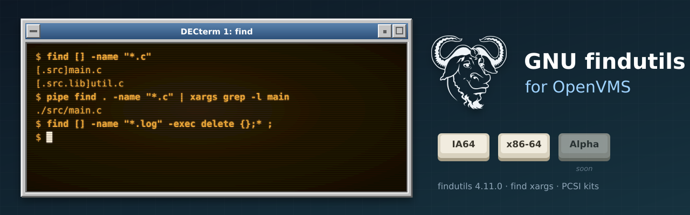

<p align="center">
  
</p>

# vms-findutils

[](https://github.com/issinoho/vms-findutils/releases/latest)
[](https://github.com/issinoho/vms-findutils/releases)

[](COPYING)

GNU findutils 4.11.0 (find, xargs and locate) for OpenVMS (IA64, x86-64 and Alpha), built natively with VSI C.

The repository stores only our changes over the signed upstream release:
- `patches/` holds changes to upstream files, applied in `patches/series` order.
- `overlay/` holds new files: VMS build procedures, C RTL shims and the PCSI kit.

`tools/prepare.sh` combines them with the tarball into `staging/`, which is pushed to a VMS node and built there with MMS. The tooling is shared with the other ports in the family; see [vms-grep](https://github.com/issinoho/vms-grep) for the list.

## Status

| Step | IA64 (V8.4-2L3) | x86-64 (E9.2-4) | Alpha (V8.4-2L2) |
|------|-----------------|-----------------|------------------|
| Configure with VSI C (`tools/vms_configure.sh`) | done | done (same answers) | IA64 answers checked on the node (see below) |
| Build (`tools/build.sh`) | clean | clean | no errors (see below) |
| DCL smoke test, 33 checks (`tools/test.sh`) | 33/33 | 33/33 | 33/33 |
| PCSI kit `ISSINOHO <base> FINDUTILS V4.11-0E<n>` (`tools/kit.sh`) | built (E3) | built (E3) | built (E3) |
| Install check (`tools/installcheck.sh`): install, smoke 25/25, clean removal (vms1) | pass | pass | not run |
| vms2 kit upgraded in place over vms1, installed smoke 30/30 | pass | pass | — |
| vms3 kit upgraded in place over vms2, installed smoke 33/33 | pass | pass | — |
| vms3 install check: install, installed smoke 33/33, clean removal | — | — | pass |

**Alpha (first kit in v4.11.0-vms3, with IA64 and x86-64):** built on
OpenVMS Alpha V8.4-2L2 with VSI C V7.4-002. The build has no errors; the compiler gives about
170 `%CC-I-QUESTCOMPARE` informational messages, `%CC-W-MISSINGRETURN` for the `usage()`-ending
`parse_help`, `parse_version` and `pred_quit` (they exit; `--help`, `--version` and `-quit` were
run), and one `%CC-W-INTOVERFL` in `parse-datetime.y` (a branch of gnulib's overflow macro that is
not taken; checked by probe). The DCL smoke test passes 33/33; kit
`ISSINOHO-AXPVMS-FINDUTILS-V0411-0E3-1.PCSI`. The Alpha shares the IA64-derived `config.h`,
checked by compiling, linking and preprocessing all 636 test programs of the IA64 configure run
on the node (same verdict for every one) plus a run-time probe; see
`overlay/vms/config/vms-manual.site`. Floating point is IEEE (`/FLOAT=IEEE_FLOAT`, as on the
other architectures): `-mmin`, `-mtime`, `-amin`, `-atime`, `-daystart`, `-printf %T@` and
`-newermt` with a relative or slash date were checked on the node. find's upstream test suite
needs GNV, which the Alpha node does not have, so only the smoke test and these checks run
there. The install check passed.

**Fixed in vms3 (all architectures):** `time_t` is unsigned on VMS, so up to vms2 `-newermt`/`-newer*t`
rejected ISO dates (`2020-01-01`) and `-used` failed with an overflow message. Patch 0012 fixes
both; the smoke test checks them.

**Requirements:** OpenVMS IA64, x86-64 or Alpha with VSI C and MMS (tested on IA64 V8.4-2L3,
x86-64 E9.2-4 and Alpha V8.4-2L2 with VSI C V7.4-002). On the host: git, bash, python3, gcc and
make, curl, gpg, groff, and ssh/sftp for the automated route. GNV for find's own test suite
(not available on the Alpha node).

## Using it

```
$ @FINDUTILS$ROOT:[000000]FINDUTILS$SETUP.COM
$ find . -name "*.c"                          ! Unix names: ./src/main.c
$ find [] -name "*.c"                         ! VMS names:  [.src]main.c
$ find [] -name "*.log" -exec delete {};* ;   ! DCL verbs work with VMS names
$ pipe find . -name "*.c" | xargs grep -l main
$ updatedb                                    ! build the locate database (privileged)
$ locate login.com                            ! DKA0:[USERS.X]LOGIN.COM
```

- **Commands:** `-exec`, `-execdir`, `-ok` and xargs run the command as DCL in a subprocess
  (LIB$SPAWN), so DCL verbs, foreign-command symbols and `@procedures` all work. The words
  you type are DCL syntax, so qualifiers work; file names are quoted unless they are VMS file
  specifications. See [docs/DECISIONS.md](docs/DECISIONS.md) D1.
- **locate:** `UPDATEDB.COM` indexes every mounted local disk (or the directories given as P1)
  into `FINDUTILS$ROOT:[DB]LOCATEDB.`; names are in VMS syntax and matched without regard to
  case. Submit it as a batch job from a privileged account to keep it current. See D3.
- **File names:** a starting point in VMS syntax (`[]`, `[.dir]`, `DKA0:[X]`, `dir.dir`) gives
  VMS names (`[.dir.sub]file.txt`, a directory as `[.dir]sub.DIR`); a Unix one (`.`, `dir`)
  gives Unix names. See D2.

**Known limits** (also in the kit's README.VMS):
- `PRODUCT REMOVE FINDUTILS` leaves a database written by UPDATEDB.COM in `[FINDUTILS.DB]`.
- `xargs -P N` runs one command at a time.
- One subprocess per command: `-exec ... ;` over many files is slow; use `-exec ... +` or
  xargs.
- A command's arguments are limited to about 4000 bytes (DCL's limit); find and xargs split
  longer lists over several commands.
- A `@procedure` gets unquoted parameters upper-cased by DCL, VMS file names included.
- `-fstype` reports `unknown`. With a VMS starting point, `-printf`'s `%h`, `%P` and `%f`
  still give Unix forms.
- `>` on the command line is not redirected by the C RTL; use `PIPE`.

## Workflow

```sh
cp tools/nodes.conf.example tools/nodes.conf   # then fill in the real nodes
tools/prepare.sh                               # fetch, verify, patch, configure, stage
tools/vms_configure.sh <node>                  # once per upstream release: configure with VSI C (the Alpha reuses the IA64 answers)
tools/build.sh <node>                          # push and build with MMS (a batch job on the Alpha)
tools/test.sh <node>                           # smoke test
tools/kit.sh <node>                            # PCSI kit
tools/installcheck.sh <node>                   # install, verify, remove
```

## What the port changes

| Change | Why |
|---|---|
| `0001-getprogname-vms` | gnulib's `getprogname` has no OpenVMS method |
| `0002-stdlib-vms-exit-severity` + `vms/vms_exit.c` | Under DCL, every non-zero exit (find's 1, xargs's 1 and 123-127) has error severity |
| `0003-config-h-assert-guard-vms` | `<assert.h>` defines `assert` again after `config.h` |
| `0004-stdio-fwrite-records-vms` + `vms/vms_fwrite.c` | Each `fwrite` item would be a record on a record-oriented stdout |
| `0005-open-directory-vms` | The C RTL cannot `open()` a directory: use gnulib's fallback |
| `0006-find-exec-without-fork-vms` + `vms/vms_spawn.c` | No `fork()`: `-exec`, `-execdir`, `-ok` run DCL through LIB$SPAWN ([D1](docs/DECISIONS.md)) |
| `0007-xargs-without-fork-vms` | The same for xargs, with its 123-127 exit statuses; `-P` runs one at a time |
| `0008-buildcmd-dcl-limit-vms` | Command lines sized for DCL (about 4000 bytes of arguments), not `ARG_MAX` |
| `0009-vms-syntax-names` + `vms/vms_names.c` | VMS-syntax starting points give VMS names ([D2](docs/DECISIONS.md)) |
| `0010-vms-frcode-output-file` | frcode writes the locate database to a named file in binary ([D3](docs/DECISIONS.md)) |
| `0011-vms-locate-ignore-case` + `vms/updatedb.com` | locate ignores case and exits through `vms_exit`; UPDATEDB.COM replaces the updatedb script |
| `0012-unsigned-time-t-dates-used` | `time_t` is unsigned on VMS: the date parser read signed numbers into it, so ISO dates (`2020-01-01`) failed in `-newermt`, and `-used` overflowed |
| `vms/vms_mountlist.c` | gnulib's mount list has no OpenVMS method; `-fstype` reports `unknown` |
| `vms-manual.site` | Configure answers the cross run cannot get, such as the C RTL's `getcwd` |
| `vms/vms_crtl_init.c` | DECC$ features: ODS-5 names, Unix name reporting, argument case |

Every problem met and its fix is in [docs/PORTING_LOG.md](docs/PORTING_LOG.md); the design
decisions are in [docs/DECISIONS.md](docs/DECISIONS.md), and the rules and pitfalls for working
on the port in `CLAUDE.md`.

## Roadmap

1. find's own test suite under GNV, as for grep and sed.
2. ~~A port to OpenVMS **Alpha**.~~ Done: see Status (Alpha kit, patch level 3).

## Licence

GNU findutils is free software under the GNU General Public License, version 3 or later;
see `COPYING`. Our patches and VMS files are distributed under the same terms.

## Artwork

`docs/images/banner.svg` and `docs/images/icon.svg` were made for this project in the style of
classic DECwindows and VT terminals, like those of its sibling ports. They incorporate the
[GNU head](https://www.gnu.org/graphics/heckert_gnu.html) by Aurelio A. Heckert, © 2003 Free
Software Foundation, Inc., used under the Creative Commons Attribution-ShareAlike 2.0 licence.
The two images are therefore also licensed under
[CC BY-SA 2.0](https://creativecommons.org/licenses/by-sa/2.0/).
